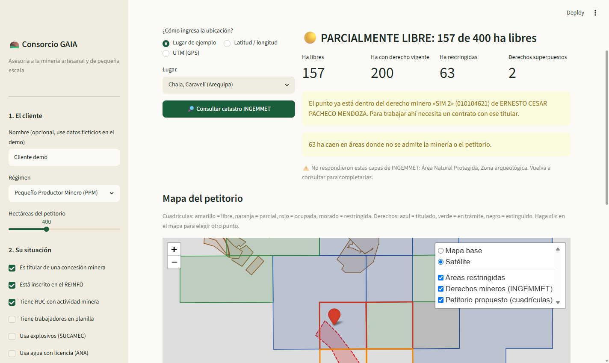
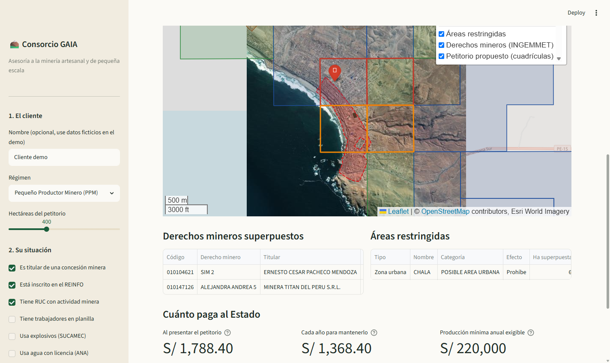
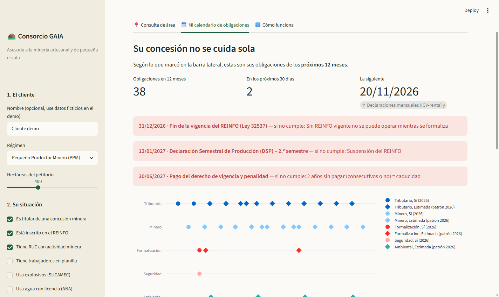
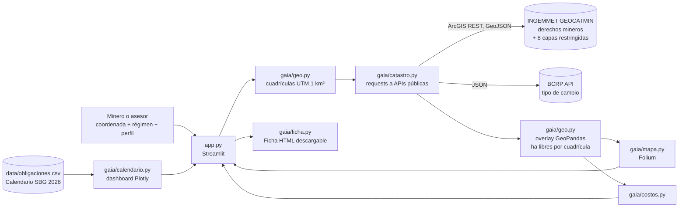

# ⛰️ Consorcio GAIA

**¿Esta zona ya tiene dueño?** Consulta de área minera y plan de cumplimiento para la pequeña minería del Perú.

> Proyecto final de la Diplomatura de Especialización en Ciencia de Datos para las Ciencias Sociales y la Gestión Pública (Q-Lab PUCP), [issue #204](https://github.com/d2cml-ai/Data-Science-Python/issues/204).

---

## 1. One-liner

**Hacemos** la consulta de área y el plan de cumplimiento de la concesión **para** los pequeños productores y mineros artesanales del Perú (y los consultores que los asesoran), **mediante** una app que consulta en vivo el catastro minero de INGEMMET, cruza con GeoPandas las cuadrículas del petitorio con los derechos mineros y las áreas restringidas, y le dice en un minuto cuántas hectáreas están libres, quién es el titular, cuánto pagará al Estado y qué obligaciones le vienen.

## 2. Founder

**Eliana Camacho Cárdenas.** Socióloga con Maestría en Gerencia Social y más de 10 años en gestión social, conflictos sociales y sostenibilidad en proyectos mineros y de infraestructura (Southern Peru, Enviroproyect, Navisan). He trabajado en el territorio con comunidades, titulares y mineros, y conozco el punto donde se traba todo: **nadie sabe con certeza de quién es el área, y las obligaciones vencen sin que el pequeño minero se entere**. El componente que ningún consultor de petitorios ofrece, la relación con el propietario del terreno y la comunidad, es justo mi especialidad.

## 3. Problema

**Quién lo sufre.** Los pequeños productores mineros (PPM) y productores mineros artesanales (PMA), unos **31,500 inscritos en el REINFO**, más quienes quieren pedir un área nueva en el sur andino (Arequipa, Cusco, Puno, Apurímac, Ayacucho).

**Cuánto le cuesta.**
- Pedir un petitorio sobre un área que ya tiene titular es **perder el derecho de trámite y el primer año de vigencia**: en un petitorio PPM de 400 ha son **S/ 1,788** (S/ 420 de trámite + US$ 400 de vigencia), sin contar viajes ni honorarios.
- No pagar el derecho de vigencia dos años hace que **la concesión caduque** y vuelva al catastro para que otro la pida.
- Si no presenta su declaración semestral, **le suspenden el REINFO**. Y el REINFO **vence el 31/12/2026**.
- Trabajar dentro de la concesión de otro sin contrato bloquea la formalización.

**Cómo lo resuelve hoy.** Entra a GEOCATMIN, un visor técnico pensado para geólogos, o paga a un tramitador. El contenido que más se busca en redes es justamente *"cómo ver en GEOCATMIN si tu zona ya tiene dueño"*: en el referente analizado, ese video suma **21.7 mil "me gusta" y 17.6 mil guardados**, y el de *"cuánto cuesta un petitorio"*, 2.8 mil. Las obligaciones se siguen con calendarios en PDF o en la memoria.

**Evidencia: 3 conversaciones con usuarios potenciales** ([`docs/research/`](docs/research/))

| # | Quién | Lo que dijo | Qué responde GAIA |
|---|---|---|---|
| 1 | [Titulares de Secocha, Arequipa](docs/research/01_titulares_secocha.md) (empresa con concesiones a su nombre) | Temen **perder sus concesiones**; cumplen e invierten "por si acaso" sin saber si los protege la producción o la inversión | Calendario que separa lo que mantiene la concesión → suscripción **Concesión Segura** |
| 2 | [J. B., titular en Apurímac](docs/research/02_titular_sin_produccion_apurimac.md) | **No produjo nada este año**: ¿cómo sustenta que no tuvo actividad?, ¿pierde la concesión? | Fechas de inversión mínima (30/04), vigencia y penalidad (30/06) y DAC (julio), más la producción mínima exigible |
| 3 | [Mineros que prospectan en Apurímac](docs/research/03_prospeccion_sin_titular_apurimac.md) | Quieren formalizarse, pero **no saben si el territorio tiene titular** | El flujo principal: consulta de área en vivo → titular, hectáreas libres y restricciones |

Además:
- Análisis de 41 publicaciones de un consultor de petitorios en TikTok (abril a noviembre de 2026): [`docs/research/00_analisis_referente.md`](docs/research/00_analisis_referente.md).

## 4. Solución e insight

**Solución.** En una pantalla, el minero (o su asesor) pone su coordenada, ya sea con el nombre del lugar, en latitud y longitud o en UTM del GPS, y GAIA:
1. arma las **cuadrículas de 100 ha** de su petitorio (100 a 1,000 ha) alineadas al catastro;
2. consulta **en vivo** a INGEMMET los derechos mineros y **8 capas de áreas restringidas** (ANP, amortiguamiento, zonas arqueológicas, zonas urbanas, ANAP, defensa nacional, reservas indígenas y territoriales);
3. calcula con GeoPandas **cuántas hectáreas quedan libres en cada cuadrícula**, quién es el titular donde está parado y qué derechos se superponen;
4. estima **cuánto pagará al Estado** con el tipo de cambio del día (API del BCRP);
5. arma su **calendario de obligaciones de los próximos 12 meses** según su perfil (titular, REINFO, RUC, planilla, explosivos, agua);
6. entrega la **ficha de consulta de área** descargable, que es el primer producto que vendemos.

**Insight.** El negocio del consultor de petitorios termina cuando sale el título, pero el problema del pequeño minero empieza ahí. La consulta de área es la puerta de entrada (alto interés, bajo precio). El dinero recurrente está en **cuidar la concesión cada año** y en **la transición del REINFO**. Además, la información ya es pública y abierta: lo que falta es traducirla en una respuesta de *sí, no o cuánto*.

## 5. Why now

- **El REINFO vence el 31/12/2026** (Ley 32537) y el Minem anunció que no habrá otra prórroga general. El proyecto de **Ley MAPE / FORMAPE** tuvo dictamen favorable en comisión en noviembre de 2026. Miles de mineros necesitan saber hoy qué hacer.
- INGEMMET publica el catastro como **servicios ArcGIS REST abiertos, actualizados a diario**, y el BCRP tiene su API de series. Hace tres años había que descargar shapefiles por carta y hoja.
- Con GeoPandas, Streamlit Community Cloud y un agente de código, **una sola persona puede construir y desplegar gratis** en días lo que antes era un sistema GIS de escritorio.

## 6. Demo

**URL pública:** https://consorcio-gaia-xzs9rqzjiohryqks4cqtkg.streamlit.app
**En local:**
```bash
git clone https://github.com/ecamachoro-bit/consorcio-gaia.git
cd consorcio-gaia
pip install -r requirements.txt
streamlit run app.py
```
No necesita claves: todas las fuentes son públicas.

**Video de respaldo (64 s, software real):** [`docs/video/demo_gaia.mp4`](docs/video/demo_gaia.mp4). Lo genera [`scripts/hacer_video.py`](scripts/hacer_video.py) con Selenium sobre la app corriendo en local.

**Casos para probar (datos reales, en vivo):**

| Lugar | Qué muestra |
|---|---|
| Chala, Caravelí (Arequipa) | 🟡 Parcialmente libre: el punto ya está dentro de una concesión titulada y parte del área es zona urbana |
| Caylloma (Arequipa) | 🟢 Libre: ~390 de 400 ha disponibles |
| Ananea (Puno) | 🔴 Ocupada: todo el bloque tiene titular |
| Pampa de Nasca (Ica) | ⛔ No viable: Líneas y Geoglifos de Nasca |

**Capturas**

| Resultado | Mapa | Calendario |
|---|---|---|
|  |  |  |

**Arquitectura**



**Modelos y APIs que usamos, y por qué**

| Fuente | Para qué | Por qué |
|---|---|---|
| INGEMMET GEOCATMIN, `SERV_CATASTRO_MINERO` (ArcGIS REST) | Derechos mineros con titular, estado y hectáreas | Es la fuente oficial, pública y se actualiza a diario |
| INGEMMET GEOCATMIN, `SERV_AREA_RESERVADA` (8 capas) | Áreas donde no se admite o se condiciona la minería | Evita pagar un petitorio que va a ser rechazado |
| BCRP API, serie `PD04640PD` | Tipo de cambio venta SBS del día | El derecho de vigencia se fija en dólares y se paga en soles |
| Calendario 2026 de obligaciones PM/MA (Swiss Better Gold) | Reglas del calendario | Es la referencia más completa para la MAPE |

**No usamos un LLM a propósito:** la respuesta tiene que ser exacta y verificable (hectáreas, titular, montos), y el usuario debe poder confiar en ella. Por eso el costo en tokens es cero.

*Nota técnica:* el servidor de INGEMMET no envía su certificado intermedio. En vez de apagar la verificación SSL, el repo incluye ese intermedio de Sectigo (`gaia/certs/`) y lo suma al paquete de `certifi`.

## 7. Modelo de negocio

**Quién paga:** el pequeño minero (PPM/PMA) o su asociación; y, en una segunda etapa, consultores y tramitadores que usan GAIA con sus clientes.

| Producto | Precio | Qué incluye |
|---|---|---|
| **Ficha de consulta de área** (puerta de entrada) | **S/ 50** por consulta | La ficha que genera la app, revisada por nosotros y enviada por WhatsApp |
| **Concesión Segura** (suscripción) | **S/ 39 al mes** por concesión | Calendario personalizado, alertas antes de cada vencimiento, revisión de la casilla electrónica, gestión del pago del derecho de vigencia |
| **Diagnóstico REINFO / Ley MAPE** (producto estrella hasta el 31/12/2026) | **S/ 350** | Estado del minero y hoja de ruta para pasar al nuevo régimen |
| Petitorio, formalización, terreno superficial | Por cotización | Servicios de asesoría con profesional habilitado |

**Costo por usuario.**
- Tokens de IA: **S/ 0** (no usamos LLM).
- Datos: **S/ 0** (APIs públicas de INGEMMET y BCRP). Cada consulta hace ~10 llamadas HTTP y tarda de 1 a 3 segundos.
- Servidor: **S/ 0** en Streamlit Community Cloud. Con más usuarios, un VPS de ~US$ 10 al mes (≈ S/ 35) atiende miles de consultas, **menos de S/ 0.05 por consulta**.
- El costo real es nuestro tiempo de revisión: ~15 min por ficha. Con S/ 50 por ficha y S/ 39 al mes por suscripción, el margen bruto supera el 80%.

**Qué sigue.** (1) Alertas automáticas por WhatsApp antes de cada vencimiento. (2) Seguimiento de las jornadas de libre denunciabilidad y de las ANAP que se liberan. (3) Lectura del expediente de INGEMMET. (4) Contenido en quechua y aimara para el sur andino.

## 8. Herramientas del curso

| Herramienta | Sesión | Dónde está | Por qué |
|---|---|---|---|
| **Scraping y APIs** | 03 | [`gaia/catastro.py`](gaia/catastro.py) | Consulta en vivo los servicios ArcGIS REST de INGEMMET (derechos mineros y 8 capas restringidas, en paralelo) y la API del BCRP |
| **GeoPandas y Folium** | 06 | [`gaia/geo.py`](gaia/geo.py), [`gaia/mapa.py`](gaia/mapa.py) | Cuadrículas UTM, overlay de polígonos para calcular las hectáreas libres por cuadrícula, y mapa interactivo con imagen satelital |
| Dashboard (extra) | 05 | [`app.py`](app.py), pestaña *Mi calendario* | Línea de tiempo y barras en Plotly con las obligaciones de los próximos 12 meses |
| Despliegue y evaluación (extra) | 12 | [`tests/test_gaia.py`](tests/test_gaia.py) | 11 pruebas automáticas sin internet: cuadrículas, cruce, costos y calendario |

## 9. Qué hizo el agente

Usé **Claude Code** como asistente de programación. La idea, el análisis del referente, el portafolio de servicios, la investigación normativa (REINFO, Ley MAPE, derechos de vigencia, calendario SBG) y la validación con usuarios son míos. Claude Code:
- encontró y probó los servicios ArcGIS REST de GEOCATMIN y la API del BCRP;
- resolvió el problema del certificado SSL de INGEMMET sin apagar la verificación;
- escribió los módulos `gaia/` (consulta, cuadrículas y overlay, mapa, costos, calendario, ficha), la app en Streamlit y las pruebas;
- convirtió el calendario del Excel en reglas (`data/obligaciones.csv`);
- tomó las capturas con Selenium y redactó este README a partir de mis insumos.

Yo revisé los resultados contra GEOCATMIN, elegí los casos del demo y definí los precios.

---

### Límites y ética
- Resultado **referencial**, no es una opinión legal. El catastro de INGEMMET tiene carácter de consulta.
- Los titulares que aparecen son **datos públicos** del catastro minero. La app no guarda datos de los usuarios.
- No atendemos operaciones en zonas prohibidas ni pedidos de "blanquear" producción ajena.

### Estructura
```
app.py                 app Streamlit
gaia/catastro.py       APIs INGEMMET y BCRP          (sesión 03)
gaia/geo.py            cuadrículas y overlay         (sesión 06)
gaia/mapa.py           mapa Folium                   (sesión 06)
gaia/calendario.py     calendario de obligaciones    (sesión 05)
gaia/costos.py         pagos al Estado
gaia/ficha.py          ficha HTML descargable
data/obligaciones.csv  reglas del calendario
tests/                 pruebas (pytest)
docs/research/         conversaciones con usuarios
docs/img/              capturas
```

Licencia MIT · © 2026 Eliana Camacho Cárdenas
